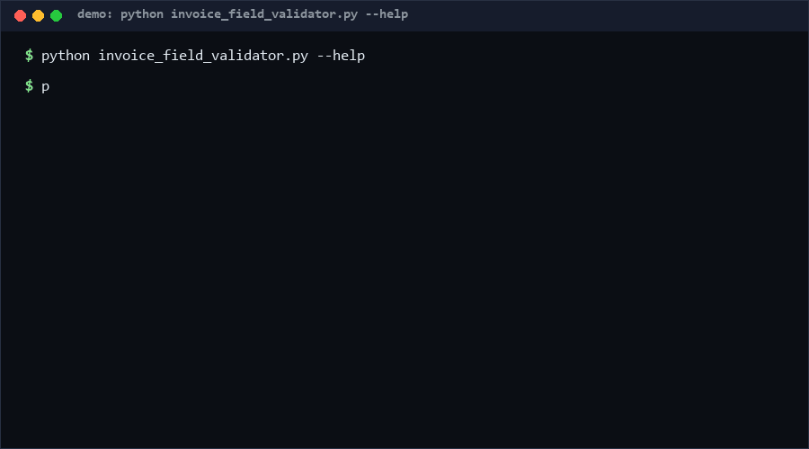

# invoice-field-validator

Catch broken invoice JSON before it reaches your ledger — with arithmetic,
not AI. The validator checks required fields, date and currency formats, and
the amount math: line amount = quantity × unit price, subtotal = sum of
lines, total = subtotal + other charges. Pure standard library, no tax rules,
no jurisdiction logic, no network. If you ingest invoices from OCR or
suppliers into a database, this is for you; if you need tax compliance, it
is explicitly not that tool.

<p align="center"></p>

## Problem

OCR and supplier portals produce invoices whose numbers don't add up: a line
says 3 × $19.99 but shows $59.98, or the subtotal doesn't match the lines,
or the total silently drops the shipping fee. These defects flow into ERP
imports and surface weeks later during reconciliation. Generic JSON-schema
validation checks *presence*; the money is wrong anyway because schema
languages can't express cross-field arithmetic well.

## How it works

Three layers of checks, all deterministic:

1. **Required fields** — `invoice_id`, `issue_date` (`YYYY-MM-DD`,
   calendar-valid, so `2026-02-30` fails), `currency` (3 upper-case letters),
   non-empty `seller.name` / `buyer.name`, non-empty `lines` array,
   numeric `subtotal` and `total`.
2. **Per-line arithmetic** — `amount` must equal `round2(quantity ×
   unit_price)` within a ±0.01 tolerance (cent rounding); `quantity > 0`,
   `unit_price >= 0`, non-empty `description`; booleans are rejected as
   numbers (`True * 50` will not sneak through).
3. **Cross-field totals** — `subtotal ≈ Σ line amounts` and
   `total ≈ subtotal + Σ other_charges` (an optional array of labeled
   generic charges — shipping, handling — not taxes). Negative totals error.

Anything named `tax`, `vat`, `gst`, or similar is *ignored with a warning*:
this tool contains no tax rates, thresholds, or rules, by design.

## Quickstart (~2 min)

```bash
# 30 s: validate a good invoice (exit 0)
cat > /tmp/inv.json <<'EOF'
{"invoice_id":"INV-001","issue_date":"2026-03-15","currency":"USD",
 "seller":{"name":"Seller Co"},"buyer":{"name":"Buyer Ltd"},
 "lines":[{"description":"consulting","quantity":10,"unit_price":100.0,"amount":1000.0}],
 "subtotal":1000.0,"total":1000.0}
EOF
python invoice_field_validator.py /tmp/inv.json

# 30 s: break the arithmetic and watch it fail (exit 1)
python -c "import json;d=json.load(open('/tmp/inv.json'));d['lines'][0]['amount']=999;json.dump(d,open('/tmp/bad.json','w'))"
python invoice_field_validator.py /tmp/bad.json

# 1 min: JSON findings for a pipeline
python invoice_field_validator.py inv.json --format json
```

## Why not X?

- **Invoice_Validator** (Deeksha-Jampulu): a Streamlit web app that
  validates vendor name, hours, rates and totals using NLP/ML "basic
  machine learning techniques", still in development. Different mechanism:
  probabilistic field checks behind a UI vs this deterministic arithmetic
  CLI with zero dependencies that you can gate a data pipeline on.
- **OCR suites with extraction models** (Textract, Docling, invoice-NLP
  pipelines): they *extract* fields. Extraction accuracy is their metric;
  post-extraction consistency of the extracted numbers is yours. Feed this
  validator whatever they extracted.
- **JSON Schema / pydantic**: express "subtotal is a number" but not
  "subtotal equals the sum of these five numbers after cent rounding" —
  cross-field arithmetic needs code. This tool is that code, packaged.

## How this differs from Invoice_Validator

That project is a Streamlit-based AI tool using Python, NLP, and basic ML
for validating invoice fields like vendor name, hours, rates and totals,
with a browser UI and a roadmap of AI summaries. This repo deliberately
inverts the mechanism: no UI, no ML, no nondeterminism — the same invoice
always yields the same findings, and every finding is one of nine named
codes you can grep. It also draws a hard line the ML approach blurs:
arithmetic consistency only, with tax fields ignored by design.

## Performance

[Measured] Windows 10, Python 3.13, 2026-10-13: validating a 400-line
invoice took **3.7 ms** in-process (median of 50 runs); cold start adds
~300 ms interpreter startup. O(lines) time and memory.

Reproduce:

```bash
python - <<'EOF'
import io, json, time, contextlib, tempfile, os
import invoice_field_validator as m
inv = {"invoice_id":"INV-1","issue_date":"2026-01-01","currency":"USD",
       "seller":{"name":"S"},"buyer":{"name":"B"},
       "lines":[{"description":"d%d"%i,"quantity":2,"unit_price":3.5,"amount":7.0}
                for i in range(400)],
       "subtotal":2800.0,"total":2800.0}
p=os.path.join(tempfile.mkdtemp(),"i.json")
json.dump(inv,open(p,"w",encoding="utf-8",newline=""))
t=time.perf_counter()
for _ in range(50):
    with contextlib.redirect_stdout(io.StringIO()):
        m.main([p,"--format","json"])
print("warm_ms=%.1f"%((time.perf_counter()-t)/50*1000))
EOF
```

## Minimal Fallback

No Python on the reconciliation box? The three arithmetic identities in
"How it works" are the whole tool. A spreadsheet with `SUM(lines.amount)`
vs `subtotal` and `subtotal+SUM(charges)` vs `total` replicates the core
checks in five minutes. The CLI adds speed, the finding codes, and CI
integration — not new math.

## Design Trade-offs

Priority order: **determinism > precision > scope**. The ±0.01 tolerance
absorbs cent rounding but nothing larger; it is applied after `round2`, and
the epsilon guard (`1e-6`) keeps float artifacts like
`3 × 19.99 = 59.97000…01` from producing false errors. A configurable
tolerance was rejected — every caller with a different tolerance becomes a
different agreement about what "adds up" means; change the constant in
source if your domain needs it. Tax logic is excluded outright because tax
rules are jurisdictional, change yearly, and would turn a 200-line
dependency-free tool into a compliance liability.

## Limits & Second-order Effects

- It validates *internal* consistency. A perfectly consistent invoice can
  still be fraudulent (right math, invented goods); supplier-master
  matching is out of scope.
- Currency is format-checked, not exchange-rate-checked; multi-currency
  invoices pass if their own numbers add up.
- If pipeline teams treat `PASS` as "the invoice is correct", extraction
  errors on *both* sides of the arithmetic (wrong quantity AND matching
  wrong amount) pass. Sample rows manually at first.

## FAQ

**Q: Why does `tax` in my JSON produce a warning?**
A: So you notice the tool saw it and deliberately did nothing. Adding tax
rules would couple this repo to jurisdictions and calendars; use a real tax
engine for that.

**Q: Does it round like my ERP?**
A: It uses Python's round-half-even on 2 decimals. If your ERP rounds
half-up, edge cases differ by a cent — the tolerance covers one cent of
disagreement.

**Q: When NOT to use this?**
A: Legal/tax compliance, fraud detection, or PDF layout checking. Also skip
it if your invoices are generated by one system that already guarantees the
arithmetic — you would be validating your own generator with itself.

## [Core Assumptions]

1. Invoice correctness at ingestion is dominated by arithmetic consistency
   (lines→subtotal→total), which is checkable without domain rules.
2. A ±0.01 absolute tolerance matches 2-decimal currency conventions used
   by the common currencies this tool targets.
3. Tax handling must stay out of a general-purpose validator: rates and
   rules vary by jurisdiction and change over time.
4. Inputs are already-extracted structured JSON; OCR/layout quality is
   upstream of this tool.

Confidence: **High (≥80%)** that the arithmetic identities catch the most
common ingestion defects — they are the failures reconciliation teams
report. **Medium (60–79%)** that the ±0.01 tolerance fits currencies with
different minor-unit conventions (e.g. 3-decimal KWD-style amounts).

*Data and measurements as of 2026-10-13.*

---

Part of the [zhengming-toolbox](https://github.com/chenhz01/zhengming-toolbox) — 105 purpose-built AI-engineering tools across neglected niches.

Related tools: [code-ownership-map](https://github.com/chenhz01/code-ownership-map) · [health-endpoint-spec](https://github.com/chenhz01/health-endpoint-spec) · [latency-budget-spec](https://github.com/chenhz01/latency-budget-spec)
